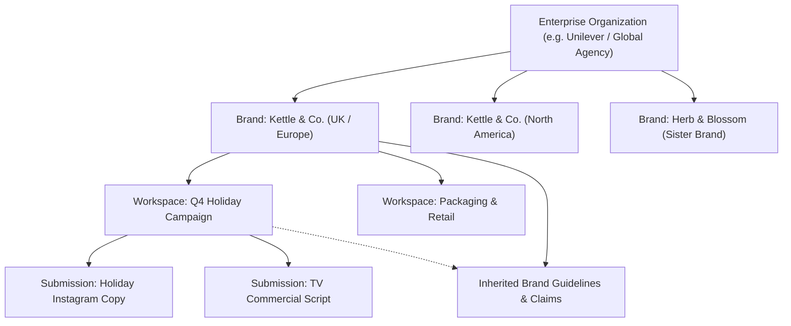
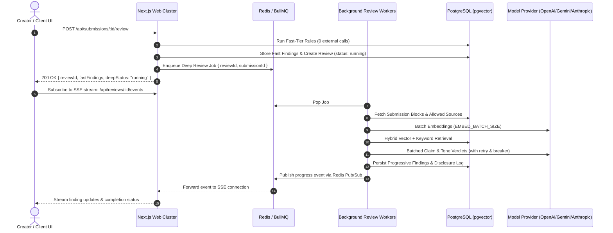
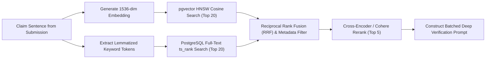
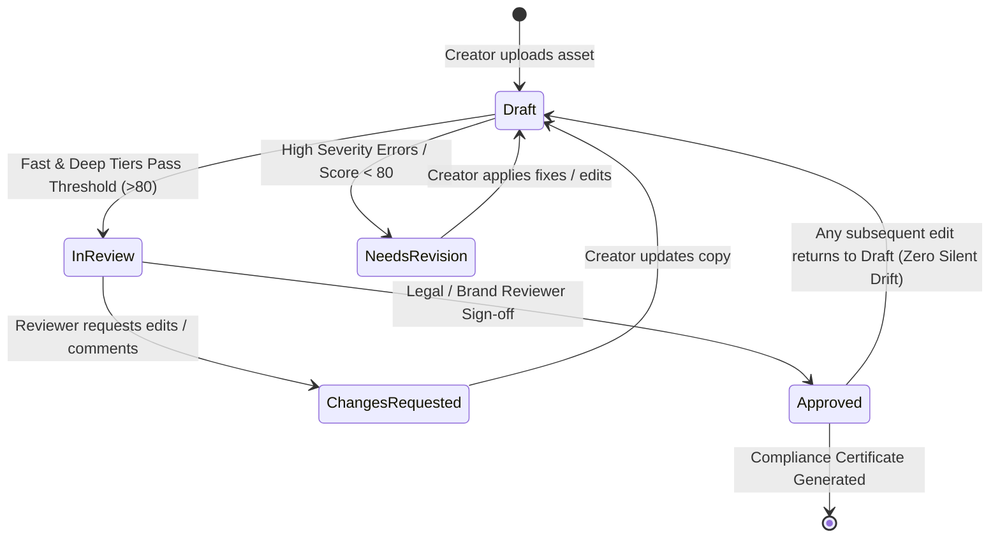
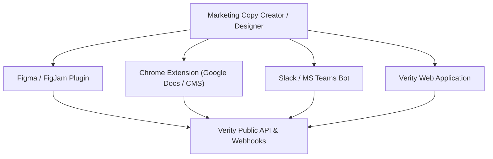

# Verity Enterprise: Industrial-Grade Brand Governance & Review Platform
## Master Engineering & Architectural Evolution Plan (`more_plan.md`)

---

## 1. Executive Summary & Architectural Gap Analysis

Verity was founded on excellent core principles: *Rules before AI*, *Retrieval before Judgement*, *Source or Silence*, and *Confidence Honesty*. In its current state, it provides a solid proof-of-concept for fast rule matching and batched LLM-based claim and tone verification.

However, moving from a single-brand, single-server demonstration app to an **industrial-grade, enterprise-ready brand governance platform** (serving Fortune 500 enterprises, global agency holding groups like Omnicom/WPP, and regulated industries like Healthcare, Financial Services, and CPG) requires closing major architectural chasms, fixing critical hidden bugs, resolving edge cases, and introducing robust enterprise capabilities.

### Current State vs. Industrial Enterprise Target

| Architectural Dimension | Current PoC Implementation | Target Industrial Enterprise Platform |
| :--- | :--- | :--- |
| **Tenancy & Branding** | Hardcoded single brand (`brandSeed.id`), global unsegmented users, seed file editing only. | Multi-tenant organization boundaries with multi-brand hierarchies (Parent Brands, Regional Brands, Product Lines, Locales). |
| **Execution Architecture** | Unhandled fire-and-forget in-process Node.js Promises (`void deepPromise.catch(...)`) with client polling. | Decoupled, distributed asynchronous job queue (BullMQ/Redis or Temporal) with real-time SSE / WebSocket streaming. |
| **Data & Storage** | Local filesystem storage (`./storage`), synchronous single-node Postgres, ephemeral in-memory maps. | S3/GCS blob storage with presigned URLs, pgvector with HNSW partitioning, read-replicas, and distributed Redis caching. |
| **Document Ingestion** | Regex sentence splitter with decimal bugs, no OCR on PDFs, image ingestion returns 0 blocks (dummy). | Native AST parsers, `Intl.Segmenter` + tokenization, OCR extraction (Tesseract / Vision AI), DOCX, PPTX, HTML, Figma, and Social Copy. |
| **Multimodal Vision** | Disabled (`ENABLE_VISION=false`), no color delta-E analysis, no logo safety zone checks. | Automated palette extraction (CIE LAB $\Delta E_{2000}$), logo clear-space detection, typography identification, WCAG accessibility. |
| **Retrieval & RAG** | Stringified SQL float vectors, top-$k=3$ vector OR keyword (disjoint), hardcoded category filter. | Hybrid search (Sparse BM25 + Dense pgvector HNSW via Reciprocal Rank Fusion) + Cross-Encoder re-ranking, metadata filtering. |
| **Workflow & Collaboration**| Destructive in-place edits, offset corruption on multiple fixes, no version diffing, no user comments. | Immutable submission versions, Operational Transformation for safe multi-finding apply, inline comment threads, redline DOCX export. |
| **Security & Compliance** | Credentials auth only, in-memory rate limiting, unmasked LLM egress, unstructured log strings. | SAML 2.0 / OIDC SSO, SCIM 2.0, tenant-level PII/PHI redaction, immutable cryptographic audit trails, SOC2 / GDPR compliance. |

---

## 2. Catalog of Critical Bugs, Race Conditions, & Edge Cases in Current Codebase

A forensic review of the existing codebase identified the following concrete bugs and architectural vulnerabilities that must be addressed:

### 2.1. Critical Functional Bugs & Offset Desync
1. **Offset Invalidation on Multiple Finding Applies (`src/app/api/findings/[id]/apply/route.ts:46-49`)**:
   - *Bug:* When a suggestion is applied, `block.text` is sliced and replaced using `finding.startOffset` and `finding.endOffset`. If the replacement string has a different length than the original text, all subsequent finding offsets within the same block become corrupted and point to invalid character ranges.
   - *Impact:* Applying a second finding in the same paragraph mutates or corrupts arbitrary text in the submission.
   - *Fix:* Implement an Operational Transformation (OT) / offset delta tracking map or re-index open findings relative to the applied edit offset.

2. **Sentence Tokenization Decimal & Abbreviation Corruption (`src/server/review/deep/candidates.ts:13-24`)**:
   - *Bug:* The regex `/[^.!?]+[.!?]+|[^.!?]+$/g` splits text on any period. Numbers with decimals (e.g., `"Over 2.5 million users"`) are split into `"Over 2."` and `"5 million users"`. Common abbreviations (e.g., `"Dr. Smith"`, `"e.g."`, `"U.S. partner estates"`) are split into nonsensical single-letter fragments.
   - *Impact:* Factual claims involving numbers and decimals are truncated mid-claim, leading to false negatives in retrieval and distorted LLM claim checks.
   - *Fix:* Replace naive regex with `Intl.Segmenter(locale, { granularity: "sentence" })` augmented with an abbreviation and numeric decimal protection tokenizer.

3. **Silent Image Ingestion Blindspot (`src/server/ingest/parse-image.ts:18`)**:
   - *Bug:* `parseImage` constructs a `NormalizedDocument` with `blocks: []`. Because `ENABLE_VISION` is false, no OCR or text extraction occurs.
   - *Impact:* An uploaded image file with egregious claim contradictions or offensive voice violations produces 0 claim candidates and 0 style findings, yielding a perfect Score of 100 with 0 findings.
   - *Fix:* Integrate OCR text extraction during ingestion so images generate inspectable text blocks for the fast and deep tiers.

4. **Hardcoded Brand & Guideline Identifiers**:
   - *Bug:* `style-rules.ts:30` hardcodes `cite("GL-3.1", sections)`. `claims.ts:109` hardcodes `"GL-4.2"`. `brand/page.tsx:28` hardcodes `brandSeed.id`.
   - *Impact:* Any new brand or organization whose guideline taxonomy does not use exact IDs `"GL-3.1"` or `"GL-4.2"` silently skips style checking or claim policies completely.
   - *Fix:* Decouple rule definitions from literal codes; use semantic guideline categories (`category: "Voice"`, `category: "ClaimsPolicy"`, `category: "Terminology"`).

5. **Reviewer Permission Asymmetry (`src/server/auth/permissions.ts:38`)**:
   - *Bug:* `can({ permission: "submissions.review" })` returns `role === "creator" && own`. Reviewers and admins cannot initiate a review check on a submission sent to them.
   - *Impact:* When a reviewer requests changes and the creator revises the text, the reviewer cannot click "Run Review" or "Re-check Deep Tier" without getting a `403 Forbidden`.
   - *Fix:* Grant reviewers and admins explicit permission to trigger reviews on submissions in review status.

### 2.2. Distributed & Concurrency Edge Cases
6. **Unhandled Background Promise Termination in Serverless/Container Environments (`src/server/review/orchestrator.ts:116-120`)**:
   - *Bug:* `startReview` launches `void deepPromise.catch(...)` without awaiting it or delegating to a persistent queue. In modern hosting environments (Vercel Serverless, AWS Lambda, Google Cloud Run), the Node.js process freezes or terminates immediately after returning the HTTP response.
   - *Impact:* Deep reviews randomly stop mid-flight or never run, leaving the review stuck in `running` status until the stale watchdog marks it `interrupted`.
   - *Fix:* Move `runDeep` execution to an external worker process via a durable job queue.

7. **In-Memory Rate Limiting Leaks and Bypass (`src/lib/rate-limit.ts:1`)**:
   - *Bug:* `userReviewTimestamps` is an in-memory `Map<string, number[]>`. In a multi-replica or auto-scaling cluster, users hit different instances and bypass rate limits. Furthermore, user keys are never evicted from the map, causing slow memory leaks over long uptimes.
   - *Fix:* Implement Redis-backed sliding-window rate limiting with automatic TTL expiration.

8. **Lossy In-Place Vector Interpolation (`src/server/review/deep/retrieve.ts:60`)**:
   - *Bug:* `const literal = \`[${vector.join(",")}]\`` manually constructs a 1,536-character comma-separated string in SQL template literals for every single sentence candidate.
   - *Impact:* High heap allocation, GC pressure, and large SQL payload sizes over TCP. In concurrent reviews, this bogs down database connections.
   - *Fix:* Bind vectors as typed binary buffers or use parameterized vector queries.

---

## 3. Enterprise Multi-Tenancy & Governance Architecture

To serve enterprise clients, the application must transition from a flat, single-brand setup into an isolated multi-tenant architecture.



### 3.1. Tenant Isolation & Hierarchical Data Model
- **Organizations (Tenants)**: Top-level billing and security boundary. Encrypts and isolates data using PostgreSQL Row Level Security (RLS) with `organization_id` on all tables.
- **Brand Trees & Inheritance**: Support parent brands with global guidelines (e.g., global logo, core voice, corporate values) inherited by child sub-brands or regional brands that add localized claims and terminology.
- **Campaigns / Workspaces**: Projects grouped by agency team, seasonal campaign, or packaging format with dedicated deadline tracking and assigned reviewers.

### 3.2. Enterprise RBAC & Granular Permission Matrix
Replace the 3 hardcoded roles with customizable enterprise roles:

| Capability / Permission | Brand Admin | Reviewer / Legal | Campaign Lead | Creator / Copywriter | Auditor / Stakeholder |
| :--- | :---: | :---: | :---: | :---: | :---: |
| **Manage Brand Guidelines & Claims** | Full | Suggest / Review | Read | Read | Read |
| **Publish / Deprecate Claims** | Yes | Yes (Legal) | No | No | No |
| **Create & Submit Content** | Yes | Yes | Yes | Yes | No |
| **Trigger AI Deep Review** | Yes | Yes | Yes | Yes | No |
| **Apply / Dismiss Auto-Fixes** | Yes | Yes | Yes | Yes (Own) | No |
| **Approve / Reject Submissions** | Yes | Yes | Yes | No | No |
| **Override / Force Ready Status** | Yes (Audit Logged) | No | No | No | No |
| **Export Compliance Reports** | Yes | Yes | Yes | Yes | Yes |
| **View Audit & Security Logs** | Yes | No | No | No | Yes |

### 3.3. Enterprise Authentication & Directory Sync
- **SAML 2.0 / OIDC Enterprise SSO**: Native integration with Okta, Microsoft Entra ID (Azure AD), Google Workspace, and Ping Identity via NextAuth / Auth.js enterprise providers.
- **SCIM 2.0 Provisioning**: Automated user provisioning and deprovisioning, role syncing, and department mapping when employees join or leave the organization.
- **Granular Session Controls**: Enforce MFA, session timeout windows, concurrent login limits, and IP address whitelisting.

---

## 4. Distributed Processing, Scalability, & Worker Architecture



### 4.1. Reliable Asynchronous Job Queue (BullMQ / Temporal)
- **Separation of Web & Worker Processes**: The Next.js web application handles HTTP requests and rule-based fast tier evaluation, immediately returning fast results in $< 100\text{ ms}$.
- **Persistent Job State**: Deep AI analysis tasks are enqueued into BullMQ backed by Redis, with persistent job retries, exponential backoff, priority queues, and concurrency throttles per provider.
- **Job Cancellation & Watchdog**: If a creator revises a submission while a deep review is processing, the active worker job receives an abort signal, halts LLM calls immediately, and frees up queue capacity.

### 4.2. Real-Time Streaming Updates (SSE / WebSockets)
- Replace client-side interval polling with **Server-Sent Events (SSE)** or **WebSockets** over Redis Pub/Sub.
- Push progressive findings to the reviewer's browser as individual batches complete, giving real-time visual progress without hitting the database on every tick.

---

## 5. Ingestion Engine & Multimodal Brand Compliance

### 5.1. Robust Text Segmentation & Format Parsing
- **`Intl.Segmenter` Pipeline**: Language-aware sentence parsing that protects numerical decimals (`3.14`), percentages (`99.9%`), monetary amounts (`$4.50`), abbreviations (`e.g.`, `i.e.`, `Inc.`), and URLs.
- **Extended Ingestion AST**:
  - **DOCX / Word**: Full style preservation (headings, bulleted lists, callout boxes, table structures, and footnotes).
  - **PDF (Vector & Raster)**: Layout-aware extraction using PDF AST, preserving multi-column reading order and extracting embedded images.
  - **Presentations (PPTX / Keynote)**: Slide-by-slide parsing, speaker notes extraction, and slide master text analysis.
  - **HTML & Email (MJML / Markdown)**: Strips tags while tracking precise visual DOM block offsets and email subject lines/preview text.

### 5.2. True Multimodal Vision & Visual Brand Assets
- **OCR Text Extraction**: Automated Tesseract / Vision AI pipeline that transcribes text in images, packaging mockups, and banner ads directly into inspectable document blocks.
- **Color Palette Verification ($\Delta E_{2000}$)**:
  - Extract dominant colors from uploaded images using k-means clustering in CIE LAB color space.
  - Compute CIE $\Delta E_{2000}$ color distance against approved `brand_colours` table entries.
  - Flag deviations where $\Delta E > \text{max\_deviation}$ as visual brand inconsistencies.
- **Logo Integrity & Safety Zones**:
  - Template matching / Object detection for brand logos.
  - Verify minimum clear-space padding, correct aspect ratio (detect stretching/skewing), and forbid low-contrast placements over busy backgrounds.
- **WCAG 2.1 AA / AAA Accessibility**:
  - Automatically evaluate color contrast ratios between text overlays and background image luminance.

### 5.3. Enterprise Cloud Asset Storage
- Move from local `./storage` to an abstraction supporting AWS S3, Google Cloud Storage, or Azure Blob Storage.
- Direct-to-bucket presigned uploads with client-side SHA-256 integrity verification.
- Asynchronous virus/malware scanning (ClamAV / AWS GuardDuty) on all uploaded media before processing.

---

## 6. Advanced Hybrid Retrieval & AI Claim Governance



### 6.1. Hybrid Search with Reciprocal Rank Fusion (RRF)
Currently, retrieval performs either vector search or keyword search, missing critical lexical exact-matches when similarity threshold is high, or missing semantic synonyms when keywords differ.
- **Hybrid Fusion Engine**: Run parallel dense vector search (HNSW index) and sparse lexical search (`to_tsvector` with dictionary lemmatization).
- **RRF Re-ranking**: Combine ranks using Reciprocal Rank Fusion formula:
  $$RRF\_Score(d) = \sum_{m \in \{dense, sparse\}} \frac{1}{60 + rank_m(d)}$$
- **Cross-Encoder Context Reranking**: Re-rank top 10 candidates down to top 3-5 with a cross-encoder model to eliminate irrelevant guideline noise before prompt construction.

### 6.2. Temporal Validity & Jurisdiction Scoping for Approved Claims
In enterprise brand governance, claims are strictly bounded by geography, audience, and regulatory lifecycles:
- **Time-Bound Claims**: Support `valid_from` and `valid_until` dates on approved claims. Flag copy using expired claims (e.g., an award won in 2024 claimed in 2026 without the year specified).
- **Jurisdiction & Regulatory Scoping**: Tag claims by market (e.g., `US-FTC`, `EU-MDR`, `UK-ASA`, `Global`). Only retrieve claims matching the submission's target distribution market.
- **Substantiation Dossiers**: Store links to evidentiary proof (clinical trials, consumer surveys, legal sign-offs). When an unapproved claim is flagged, give the creator a direct path to request claim substantiation from the Legal team.

### 6.3. Dynamic Provider Routing & Fallback Cascades
- Multi-provider support beyond generic OpenAI compatibility: direct integrations with Google Gemini Pro/Flash, Anthropic Claude 3.5 Sonnet, and local private models (Ollama / vLLM / HuggingFace TGI).
- Dynamic model cascade: Route simple claim verification to fast low-cost models (e.g. Flash Lite / Claude Haiku), escalating complex nuances or low-confidence verdicts to flagship frontier models (Claude 3.5 Sonnet / GPT-4o).
- High-availability circuit breaking: If Provider A experiences a 503 outage or 429 quota exhaustion, seamlessly switch traffic to Provider B with zero downtime.

---

## 7. Collaborative Review, Redlining, & Versioning



### 7.1. Immutable Submission Versioning & Visual Diffing
- Never overwrite `submissions` in place.
- Implement `submission_versions` table storing `v1, v2, v3, ...` with full AST snapshots, creator timestamps, and associated reviews.
- **Visual Redline & Diff Engine**: Side-by-side and unified diff view showing exact text added, deleted, or revised between versions, with highlighted findings overlaid on the diff.

### 7.2. Contextual Team Commenting & Reviewer Annotations
- Allow human reviewers, copywriters, and legal counsel to highlight any arbitrary span in the document and start a threaded conversation.
- Support `@mentions`, email/Slack notifications, and comment resolution states (`open`, `resolved`, `reopened`).
- Distinguish between **AI-generated findings** and **Human-created review remarks**.

### 7.3. Non-Destructive Multi-Finding Apply & Batch Fixes
- Support "Apply All Safe Suggestions" with atomic transaction rollback.
- Offset transformation algorithm:
  ```ts
  function applyMultipleFixes(blockText: string, fixes: FindingFix[]): string {
    // Sort fixes descending by startOffset so earlier offsets remain valid
    const sorted = [...fixes].sort((a, b) => b.startOffset - a.startOffset);
    let result = blockText;
    for (const fix of sorted) {
      result = result.slice(0, fix.startOffset) + fix.replacement + result.slice(fix.endOffset);
    }
    return result;
  }
  ```
- Round-trip DOCX / PDF redlining: When reviewing Word documents, generate a downloadable `.docx` with real Microsoft Word **Tracked Changes** reflecting applied fixes and reviewer comments.

### 7.4. Compliance Certificate & Audit Exports
- Generate cryptographic, tamper-evident **Brand Compliance Certificates** in PDF format upon final approval:
  - Document title, version, hash (SHA-256).
  - Approving reviewer identity, role, and digital sign-off timestamp.
  - Complete list of cited approved claims with substantiation references.
  - Complete audit record of dismissed warnings with documented business justifications.
- CSV and JSON export endpoints for enterprise data warehouses and regulatory audit inspections.

---

## 8. Brand Rule Studio & Guideline Management UI

Currently, existing rules can only be edited by modifying the backend seed file `brand.json`. Enterprise brand managers require a rich administrative UI.

### 8.1. Full CRUD Rule Studio
- **Approved Claims Manager**:
  - Rich text editor with version history and approval workflow.
  - Tagging system (e.g., `#sustainability`, `#organic`, `#award2025`).
  - Active / Inactive / Deprecated toggle with replacement pointer.
  - Substantiation document attachment uploads.
- **Terminology & Glossary Studio**:
  - Bulk CSV / Excel / TBX (TermBase eXchange) import and export.
  - Match modes: exact word, lemma, regex pattern, case-sensitive.
  - Scope: Global vs. Brand-specific vs. Channel-specific (e.g., Social vs. Legal packaging).
- **Style & Voice Rule Builder**:
  - No-code visual rule builder (e.g., "Disallow sentences exceeding 25 words", "Disallow passive voice in headlines").
  - Configurable severity (`error`, `warn`, `question`) and cost weight towards readiness score.

### 8.2. Guidelines Staging & Publication Lifecycle
- Guidelines themselves undergo governance!
- Support **Draft Guidelines** vs. **Published Guidelines**.
- Brand managers can stage new claims or updated terminology, test them against historical testset submissions in a sandbox preview, and publish to production with a scheduled rollout.

---

## 9. Enterprise Security, Privacy, & Observability

### 9.1. PII & Sensitive IP Redaction (Privacy-Preserving AI)
- In enterprise environments, unreleased marketing copy may contain proprietary trade secrets, unannounced product codenames, or employee personal data.
- **Pre-Egress Anonymization**: Before any sentence excerpt is sent to an external LLM:
  - Detect and mask PII (names, phone numbers, email addresses, credit cards) using Presidio / regex NER.
  - Detect internal codenames mapped to synthetic placeholders (`[PROJECT_ALPHA]`), reversing the substitution when verdicts are returned.
  - Provide a strict "Zero Data Retention" compliance header verification (`X-No-Train`) for enterprise AI providers.

### 9.2. Tamper-Evident Audit Logging
- Enhance `activity_log` into an immutable ledger:
  - `actor_id`, `actor_email`, `actor_role`
  - `client_ip_address`, `user_agent`
  - `action_type` (`submission.created`, `review.started`, `finding.dismissed`, `claim.overridden`, `submission.approved`)
  - `metadata_json` with before/after state diffs
  - Cryptographic hash chaining ($Hash_n = SHA256(Hash_{n-1} + Payload_n)$) ensuring log records cannot be altered retroactively.

### 9.3. Production Telemetry & Observability
- **OpenTelemetry Instrumentation**: Distributed tracing across HTTP requests, Drizzle DB queries, Redis queue operations, and LLM completions.
- **Prometheus Metrics**:
  - `verity_review_duration_seconds` (histogram by tier and status)
  - `verity_ai_provider_calls_total` (counter by provider, model, and status code)
  - `verity_ai_token_usage_total` (counter by model and prompt/completion)
  - `verity_findings_flagged_total` (counter by rule kind and severity)
  - `verity_active_workers_count` (gauge)
- **Grafana Operational Dashboards**: Real-time visibility into queue latency, LLM rate-limit headroom, circuit breaker states, and daily cost per brand.

---

## 10. Ecosystem Integrations & Native Plugins

An enterprise brand review manager must live where creators write copy:



1. **Browser Extension (Chrome / Edge)**:
   - Evaluates copy in-place inside Contentful, WordPress, Sanity, HubSpot, LinkedIn, and Google Docs.
   - Highlights brand violations directly on the webpage with one-click fixes.
2. **Figma / Adobe Express Plugin**:
   - Scans text frames and vector layers directly inside design canvases.
   - Checks visual layout, brand color accuracy, and typography in real-time.
3. **Slack & Microsoft Teams Notifications**:
   - Interactive messages alerting reviewers when submissions are ready.
   - Quick "Approve" or "View Flags" buttons directly inside chat channels.
4. **Public REST & Webhook API**:
   - `POST /api/v1/submissions`: Programmatic ingest from CI/CD or marketing automation workflows.
   - Webhook subscriptions for `review.completed`, `submission.approved`, and `claim.expired`.

---

## 11. Comprehensive Phased Implementation Roadmap

To systematically transform Verity into this industrial-grade platform without breaking existing behavior, execute in four structured milestones:

### Phase 1: Core Reliability, Ingestion Hardening, & Bug Remediation
- [ ] Replace naive regex sentence splitter with `Intl.Segmenter` and numeric/abbreviation protection.
- [ ] Implement offset delta tracking / Operational Transformation in `apply/route.ts` to prevent text corruption on multiple fixes.
- [ ] Integrate basic OCR text extraction into `parse-image.ts` and layout-aware PDF multi-column parsing.
- [ ] Decouple hardcoded guideline identifiers (`GL-3.1`, `GL-4.2`, `brandSeed.id`) into database-driven category queries.
- [ ] Extend reviewer permissions so reviewers and admins can re-run reviews on submissions in review.

### Phase 2: Multi-Tenancy, Enterprise RBAC, & Distributed Queues
- [ ] Add `organizations` table, tenant-level RLS, and multi-brand hierarchies in database schema.
- [ ] Integrate BullMQ / Redis worker process to isolate `runDeep` from web requests.
- [ ] Replace interval polling with Server-Sent Events (SSE) streaming review progress and findings in real time.
- [ ] Integrate SAML 2.0 / OIDC SSO and SCIM user provisioning.
- [ ] Migrate in-memory rate limiting to Redis-backed sliding window token buckets.

### Phase 3: Hybrid Retrieval, Multimodal Vision, & Collaborative Workspace
- [ ] Implement hybrid retrieval (dense pgvector HNSW + sparse tsvector) with Reciprocal Rank Fusion (RRF).
- [ ] Add temporal validity (`valid_until`), market/jurisdiction scoping, and evidentiary attachments to approved claims.
- [ ] Build Multimodal Vision Engine ($\Delta E_{2000}$ color distance against brand palette, logo clear space).
- [ ] Build immutable `submission_versions` and visual redline diff viewer.
- [ ] Implement collaborative threaded comments and `@mentions` on submission blocks.

### Phase 4: Enterprise Rule Studio, Compliance Exports, & Ecosystem Integrations
- [ ] Build full Administrative UI Studio for creating, updating, staging, and publishing brand guidelines and claims.
- [ ] Implement downloadable PDF Brand Compliance Certificates with cryptographic hashes and sign-off records.
- [ ] Develop Tracked Changes Word (.docx) export reflecting applied findings.
- [ ] Deploy OpenTelemetry instrumentation, Prometheus metrics, and Grafana dashboard templates.
- [ ] Release public REST API, Webhooks, and Chrome Extension for in-situ CMS review.

---

*This document serves as the architectural blueprint and operational roadmap for scaling Verity into an enterprise-grade brand governance platform.*
